# 🚢 Awesome Ship Maintenance Management

    

## ⚓ Comprehensive Ship & Fleet Maintenance Management Ecosystem

> **A curated list of top commercial SaaS platforms and open-source GitHub projects for maritime Planned Maintenance Systems (PMS), Marine CMMS, vessel work orders, spare parts inventory, running-hour counters, dry-dock planning, and fleet technical management.**

---

## 💡 Overview & SEO Keywords

The **Ship Maintenance Management** ecosystem encompasses software solutions tailored for shipowners, fleet managers, technical superintendents, marine engineers, and port operators. Key operational focus areas include:
* 🛠️ **Planned Maintenance Systems (PMS)** & Marine CMMS
* 📜 **Class & ISM Regulatory Compliance** (IMO, SOLAS, MARPOL, ABS, DNV, Lloyd's Register)
* ⚙️ **Running-Hour & Engine Counter Logging**
* 📦 **Spare Parts Inventory & IMPA Logistics**
* 🚢 **Dry-Docking, Survey & Defect Tracking**
* 📊 **Fleet Technical Management & Condition Monitoring**

---

## 📑 Table of Contents

- [🏢 SaaS & Hosted Commercial Platforms](#-saas--hosted-commercial-platforms)
- [💻 Open-Source GitHub Projects](#-open-source-github-projects)
- [🛠️ Key Architectural Components](#%EF%B8%8F-key-architectural-components)
- [🤝 How to Contribute](#-how-to-contribute)
- [⚖️ Disclaimer](#%EF%B8%8F-disclaimer)
- [📈 Star History](#-star-history)

---

## 🏢 SaaS & Hosted Commercial Platforms

> 🌐 **Market Overview & Industry Structure**:  
> The global **Maritime PMS & Fleet Maintenance Software Sector** is estimated at **~$2.5 Billion USD**, growing at ~7.8% CAGR toward $5.0+ Billion by 2030. The market is **Highly Fragmented** (with no single provider controlling >15% market share) due to diverse vessel types (containers, tankers, bulkers, tugboats, offshore OSVs) and regional operator preferences.

| 🚢 Platform / Product | 📝 Description & Focus | 💰 Pricing (Starting Tier) | 🎁 Free Tier Limit | 📊 Company Size (Rev / Valuation) |
| :--- | :--- | :--- | :--- | :--- |
| **[IBM Maximo Marine](https://www.ibm.com/products/maximo)** | Enterprise asset management configuration of IBM Maximo Suite for heavy marine and offshore fleets. | **$3,150 / month** (Essentials tier supporting up to 25 users via AppPoints) | 14-day free trial (sandboxed experience preloaded with sample data; 0 free-forever tier) | **~$62B Revenue / $170B+ Market Cap** (IBM Enterprise Software) |
| **[SpecTec AMOS](https://www.spectec.com/)** | Industry-standard maritime maintenance, procurement, and asset management platform for complex fleets. | **$350 / vessel / month** (Starting tier for base PMS module; ~$4,200 / vessel / year) | No free trial (0 days; live demo & free essential health check on request; 0 free-forever tier) | **~$60B+ Market Cap Parent** (Constellation Software / Volaris; ~$50M+ PMS rev) |
| **[Fiix CMMS](https://www.fiixsoftware.com/)** | AI-driven cloud CMMS by Rockwell Automation for vessel equipment maintenance and asset performance. | **$45 / user / month** (Basic plan; Professional tier at $75 / user / month) | Free Forever plan (up to 3 users & 25 active PM tasks); 0-day free trial for paid plans | **~$30B+ Market Cap Parent** (Rockwell Automation; ~$35M+ ARR) |
| **[MariApps (smartPAL PMS)](https://www.mariapps.com/)** | Flagship smartPAL enterprise PMS serving global container, tanker, and ship management fleets. | **$250 / vessel / month** (Starting subscription tier for smartPAL PMS module) | No free trial (0 days; interactive demo available upon request; 0 free-forever tier) | **~$2B+ Parent Revenue** (Schulte Group; ~$40M+ digital maritime rev) |
| **[MaintainX](https://www.getmaintainx.com/)** | Modern mobile-first SaaS CMMS used by maritime operators for vessel work orders and PM checklists. | **$20 / user / month** (Essential plan; Premium tier at $65 / user / month) | Free Forever plan (1 admin user, unlimited work orders & assets); 14-day trial for paid tiers | **~$1.0B Valuation** (Venture-backed; ~$40M+ ARR) |
| **[ABS Nautical Systems (NS5)](https://ww2.eagle.org/)** | Class-society-backed fleet technical management and maintenance platform built for ocean compliance. | **$1,500 / vessel / month** (Estimated starting tier for core NS fleet maintenance package) | No free trial (0 days; scheduled consultation & demo on request; 0 free-forever tier) | **~$800M+ Parent Revenue** (American Bureau of Shipping / ABS Wavesight) |
| **[UpKeep](https://www.upkeep.com/)** | Cloud SaaS CMMS platform adapted for fleet, vessel, and maritime facility maintenance workflows. | **$24 / user / month** (Essential plan; Premium tier at $55 / user / month) | 7-day free trial (full access to Essential/Premium features, no credit card required) | **~$300M+ Valuation** (Venture-backed; ~$20M+ ARR) |
| **[Helm CONNECT](https://www.helmoperations.com/)** | Modern maritime operations platform with planned maintenance, compliance, and crew modules for harbor & coastal fleets. | **$99 / vessel / month** (Base Compliance tier; Certifications module ~$50 / vessel / month) | No free trial (0 days; live demo available upon request; 0 free-forever tier) | **~$30M - $50M Revenue** (Volaris Group / Constellation Software) |
| **[DANAOS Maintenance](https://www.danaos.gr/)** | Technical management and PMS capabilities within the broader DANAOS shipping enterprise suite. | **€20,000 one-time base license** (or ~$500 / vessel / month enterprise subscription tier) | No free trial (0 days; custom live demo available upon request; 0 free-forever tier) | **~$25M - $40M Revenue** (DANAOS Management Systems Ecosystem) |
| **[ShipNet](https://www.shipnet.no/)** | Integrated maritime ERP covering technical PMS, commercial chartering, and financial management. | **$400 / month** (Subscription starting tier for core technical PMS module) | No free trial (0 days; custom live demo available upon request; 0 free-forever tier) | **~$15M - $30M Revenue** (Volaris Group / Constellation Software) |
| **[MESPAS](https://www.mespas.com/)** | Cloud-oriented marine technical management platform focused on PMS and maritime supplier procurement integration. | **$150 / vessel / month** (Technical Ship Management module starting tier rate) | Free-forever Procurement module for office users; 0-day free trial for full TSM suite | **~$10M - $20M Revenue** (MESPAS AG, Switzerland) |
| **[Task Assistant Marine](https://www.ulysses-systems.com/)** | Process-driven marine PMS and technical management software for fleet compliance by Ulysses Systems. | **$200 / vessel / month** (Starting subscription tier for Task Assistant PMS module) | No free trial (0 days; tailored presentation/demo upon request; 0 free-forever tier) | **~$5M - $15M Revenue** (Ulysses Systems, Greece/UK) |

---

## 💻 Open-Source GitHub Projects

> 🌟 **Community & Open-Source Overview**:  
> While regulatory class-society integrations are predominantly proprietary, open-source projects provide flexible foundations for custom vessel PMS, IoT telemetry, equipment tracking, and running-hour counters.

| 📦 Repository & Project | 📜 Description & Focus | ⭐ Star Count |
| :--- | :--- | :--- |
| **[Odoo Maintenance & Fleet](https://github.com/odoo/odoo)** | Extensive open-source ERP with dedicated equipment maintenance, fleet management, and preventive maintenance modules adaptable for vessel operations. |  |
| **[ERPNext Maintenance](https://github.com/frappe/erpnext)** | Full-featured open-source ERP suite including asset management, preventive maintenance schedules, running-hour tracking, and spare-parts inventory. |  |
| **[Node-RED](https://github.com/node-red/node-red)** | Low-code IoT flow engine widely used aboard ships for capturing equipment telemetry, running hours, and engine sensor readings to trigger maintenance schedules. |  |
| **[Snipe-IT Asset Manager](https://github.com/grokability/snipe-it)** | Open-source asset management platform designed to track vessel equipment, serial numbers, locations, licenses, and onboard maintenance history. |  |
| **[InvenTree Spare Parts](https://github.com/inventree/InvenTree)** | Open-source inventory & spare-parts management system with component hierarchy, stock tracking, and supplier integration ideal for vessel spares. |  |
| **[Grash CMMS](https://github.com/Grashjs/cmms)** | Self-hosted open-source Computerized Maintenance Management System web & mobile application for work orders, preventative maintenance, and asset tracking. |  |
| **[SuperCMMS](https://github.com/SuperCMMS/Open-Source-CMMS)** | Open-source CMMS backend designed for customizable asset tracking, work-order generation, and maintenance logs adaptable to marine environments. |  |
| **[Liberu Maintenance](https://github.com/Liberu-Maintenance/liberu-maintenance)** | Modern Laravel-based open-source maintenance management system for asset tracking and preventive maintenance scheduling. |  |
| **[ShipShape Maritime PMS](https://github.com/ashfaaqrifath/ShipShape-Maritime-Maintenance-System)** | Maritime-specific open-source PMS designed to streamline vessel upkeep, equipment inspection schedules, and spare-parts inventory. |  |
| **[ShipChandlerHub](https://github.com/ryantusi/ShipChandlerHub)** | Web-based maritime vessel tracking, spare-parts inventory, and order management system built around IMPA codes. |  |
| **[Naval Vessel Maintenance Data & PDM](https://github.com/trewaite/Naval-Vessel-Maintenance)** | Condition-based maintenance models and machine-learning dataset for naval vessel gas turbine propulsion plants and predictive maintenance. |  |

---

## 🛠️ Key Architectural Components

When evaluating or building a **Ship Maintenance System**, ensure support for:
1. 📴 **Offline-First Synchronization**: Ships operate with intermittent satellite internet (Starlink, VSAT); data must sync seamlessly when connected.
2. ⏱️ **Counter & Running-Hour Triggers**: Maintenance tasks triggered by elapsed machinery hours (e.g. main engine overhaul every 4,000 hours).
3. 📦 **IMPA / ISSA Spare Parts Hierarchy**: Structured cataloging of vessel spare parts with minimum stock alerts.
4. 📋 **Class Society & Audit Logs**: Immutable audit trails for DNV, ABS, Lloyd's Register, and ISM Code compliance.

---

## 🤝 How to Contribute

1. 🍴 Fork this repository.
2. ➕ Add/edit entries in `README.md` following the tabular format.
3. 📝 Include project name, link, concise 1–2 sentence description, pricing/star count, and official source links.
4. 🚀 Submit a Pull Request with a clear explanation of your additions.

Reference: Check out [Awesome Lists](https://github.com/ishandutta2007/Awesome-Awesome-Awesome) for contribution guidelines.

---

## ⚖️ Disclaimer

- This repository is a **community-curated list** for informational and research purposes only.
- Maritime maintenance systems directly impact life safety and regulatory compliance (SOLAS, ISM Code). Always perform technical due diligence before deploying maintenance management software aboard commercial vessels.

---

## 📈 Star History

---

**Made with 💙 for Technical Superintendents, Fleet Managers, Chief Engineers, and Maritime IT Teams.**
